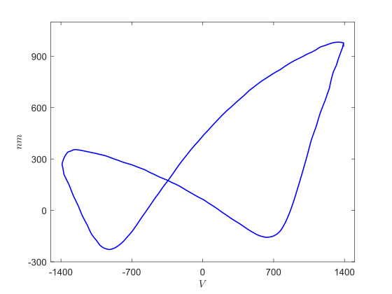
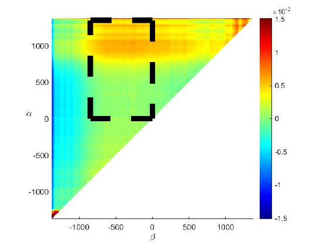
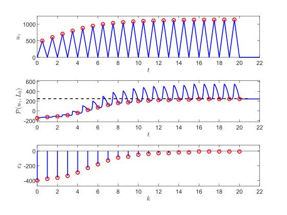

<div align="center">

# Preisach Hysteresis Model

**Relay-based Preisach operator in MATLAB: fitting to measured strain–voltage loops, Simulink feedback loops, and remnant-control simulations.**

[](https://www.mathworks.com/products/matlab.html)
[](https://www.mathworks.com/products/simulink.html)
[](https://github.com/mavasbel-research/matlab-preisach-model/commits/main)
[](#-known-issues)
[](https://doi.org/10.33612/diss.215199709)

<table>
<tr>
<td align="center" width="33%"><br><sub>Butterfly strain–voltage loop (nm vs V)</sub></td>
<td align="center" width="33%"><br><sub>Preisach weighting function on the (β, α) plane</sub></td>
<td align="center" width="33%"><br><sub>Remnant control: pulses, output and error per iteration</sub></td>
</tr>
</table>

</div>

> [!NOTE]
> Research code from the PhD thesis [*Multi-loop Hysteresis and Recursive Remnant Control*](https://doi.org/10.33612/diss.215199709) (University of Groningen, 2022). It is kept as it was left in December 2021 — read [Known issues](#-known-issues) before running it.

## 📑 Contents

- [Overview](#-overview)
- [Repository layout](#-repository-layout)
- [Requirements](#-requirements)
- [Getting started](#-getting-started)
- [Workflows](#-workflows)
- [Included measurement data](#-included-measurement-data)
- [Known issues](#-known-issues)
- [Related publications](#-related-publications)
- [Citation](#-citation)
- [Third-party code and license](#-third-party-code-and-license)

## 🔎 Overview

The Preisach operator is modelled as a grid of two-state relays (`relayOnVal = 1`, `relayOffVal = -1`) over a triangular input domain, each weighted by a weighting function. On top of that model the repository provides:

| Capability | Where |
|:---|:---|
| Relay-grid Preisach model (`PreisachRelayModel`) and least-squares fitting of its weighting function (`PreisachRelayUtils.fitModel`, regularised with γ = 0.1) | `Classes/` *(see [Getting started](#-getting-started))* |
| Synthetic weighting functions and major-loop generation | `CreateWeightFunc.m`, `GenerateOutput.m`, `RecordVideo.m` |
| Fitting to measured loops in batch or against other files | `FitBatch.m`, `FitCompare.m`, `FitModel.m` |
| Preisach operator in a feedback loop with a third-order LTI plant, including a passivity check (`isPassive`) | `CDC2019/`, `TAC2020/TACSimulinkParams.m` |
| Loop-shape examples: butterfly, double loop, multi-loop, trivial crossovers | `TAC2020/example_*` |
| Remnant control by iterative pulse-amplitude updates, single and multi-actuator (iterative learning control) | `CDC2020/`, `Remnant_ILC/` |
| Readers and plots for measured remanent-strain experiments | `Remnant_Measurements_1/`, `Remnant_Measurements_2/` |

## 🗂️ Repository layout

| Path | Contents |
|:---|:---|
| `Classes/` | `PreisachInterfaceModel.m` (memory-curve variant) |
| `CDC2019/` | Synthetic model, Simulink feedback loop `Simulink/CDC2019Preisach.slx` (R2020a), fit of the 1600 V loop in `Serie1.mat` |
| `CDC2020/` | Remnant control on a fitted model (`RemnantControl.m`), result plots, example images |
| `TAC2020/` | Simulink loop `Simulink/TAC2019Preisach.slx` (R2018b), loop-shape examples, symbolic area checks |
| `Remnant_ILC/` | Synthetic or fitted model arrays and single/multi-actuator remnant ILC with coupling |
| `Remnant_Measurements_1/`, `Remnant_Measurements_2/` | Readers, data classes and plotters for remanent-strain measurements (data included) |
| `Piezo_Setup/` | Triangle and fading test-signal generator (`TriangleWaveGenerator.m`) |
| `Simulink/` | Early models `SimplePreisach.slx`, `SwitchingPreisach.slx` (R2017b) |
| `figures/` | Presentation figures |
| *root* | Entry scripts listed above, `CaptureLoop.m` (draw a loop with the mouse), `GenerateLTISOutput.m` |

## 🧰 Requirements

| Requirement | Used by |
|:---|:---|
| MATLAB R2017b or later (models were saved with R2017b, R2018b and R2020a) | everything |
| Simulink | `*.slx` models |
| Control System Toolbox (`tf`, `ss`, `lsim`, `isPassive`, `nyquist`) | `CreateSimulinkParams.m`, `GenerateLTISOutput.m`, `CDC2019/`, `TAC2020/` |
| Signal Processing Toolbox (`findpeaks`) | `CaptureLoop.m`, `DataHandler` |
| Symbolic Math Toolbox (`syms`, `triangularPulse`, `fsurf`) | `Piezo_Setup/`, `TAC2020/` symbolic scripts |
| Java-enabled MATLAB (`java.security.MessageDigest`) | `PreisachRelayUtils` |

## 🚀 Getting started

> [!IMPORTANT]
> The last commit (`e083eb9`, *Refactor of commons*) removed the core classes from `Classes/`. Restore them from the previous commit before running any model script:

```bash
git clone https://github.com/mavasbel-research/matlab-preisach-model.git
cd matlab-preisach-model
git checkout 7409024 -- Classes
```

This brings back `PreisachRelayModel`, `PreisachRelayUtils`, `DataHandler`, `DataPlotter`, `FileHandler` and `FitPlotter`. Then, in MATLAB, from the repository root:

```matlab
addpath('Classes')
CreateWeightFunc      % builds preisachRelayModel and plots the major loop
GenerateOutput        % 1 Hz sine input through the model
```

> [!TIP]
> Add folders one at a time instead of `addpath(genpath(...))`: `DataPlotter`, `CreateWeightFunc` and `plotRectangle` exist in several folders with different contents, and the copy found first on the path wins.

## 🔁 Workflows

The scripts share state through the MATLAB base workspace, so the order matters. These sequences follow the variables each script reads and writes; they have not been re-run since 2021.

<details open>
<summary><b>Remnant measurement analysis</b> — runs without the restored classes</summary>

```matlab
cd Remnant_Measurements_2
FileReader                    % reads the triangular-pulse .dat files into `measurements`
SinglePulseRemnantPlotter     % remnant vs pulse amplitude (200:100:1600 V)
MultiPulseRemnantPlotter      % remnant differences for two-pulse sequences
```

`Remnant_Measurements_1/MeasurementReader.m` followed by `RemnantPlotter.m` does the same for the first measurement set.
</details>

<details>
<summary><b>Synthetic model, output and video</b></summary>

```matlab
CreateWeightFunc   % 500 x 500 symmetric weighting function, prints the major-loop area
GenerateOutput     % input/output/loop plots
RecordVideo        % writes video.avi
```
</details>

<details>
<summary><b>Preisach operator in a Simulink feedback loop (CDC2019)</b></summary>

```matlab
cd CDC2019
CDC2019CreateWeightFunc   % also runs CDC2019SimulinkParams (plant, Phik = -1/Gk, isPassive)
% open Simulink/CDC2019Preisach.slx and run it (StopTime = simTotalTime)
CDC2019Plots              % uses xt, Phiu, Phiy written by the model
```

`CDC2019FitModel.m` fits the model to the measured 1600 V loop stored in `Serie1.mat` with grid resolutions 10, 25 and 50.
</details>

<details>
<summary><b>Remnant control with iterative learning (Remnant_ILC)</b></summary>

```matlab
cd Remnant_ILC
CreatePreisachModels      % synthetic base model + array of 6 copies
SimpleRemnantILC          % single actuator
MultiRemnantILCControl    % 4 coupled actuators (coupling 0.50, K0 = 0.28)
MultiRemnantILCPlots
```

`CDC2020/RemnantControl.m` runs the same idea on a model fitted to measurements, which requires the external data described under [Known issues](#-known-issues).
</details>

<details>
<summary><b>Loop-shape examples (TAC2020)</b></summary>

```matlab
cd TAC2020/example_butterfly      % or example_multiloop, example_doubleloop_same_oriented, example_trivial_crossovers
CreateWeightFunc                  % writes the example figures as .eps
```
</details>

## 📊 Included measurement data

| Folder | Files | Date in file header |
|:---|:---|:---|
| `Remnant_Measurements_1/data/` | 2 `.dat` exports, 2 `.tfz` projects | 23 Jul 2019 |
| `Remnant_Measurements_2/remnant_measurements/triag/` | 5 `.dat`, 5 `.tfz`, 75 `.tfw` waveforms | 22–23 Aug 2019 |
| `Remnant_Measurements_2/remnant_measurements/trap/` | 6 `.dat`, 6 `.tfz`, 52 `.tfw` waveforms | 22–23 Aug 2019 |
| `CDC2019/Serie1.mat`, `CDC2019/MeasurementData.mat` | Strain–voltage loops, 401 samples per signal | 2018, 2017 |

The `.dat` headers identify the equipment: aixPlorer 3.0.44.0 with a TF Analyzer 2000 E, a TREK 610E 10 kV amplifier and a SIOS interferometer. Columns are `Time [s] V+ V- I1 P1 I2 P2 I3 P3 D1 D2 D3 CH3`. The repository is about 450 MB, almost all of it these files.

## ⚠️ Known issues

| Issue | Where | Workaround |
|:---|:---|:---|
| Core classes removed by the last commit | `Classes/` | `git checkout 7409024 -- Classes` |
| `getStrainDataHandler()` is called but was never defined; `FileHandler` provides `getDataHandler` | `FitBatch.m:66` | Use `getDataHandler` |
| Experimental data for batch fitting is read from absolute `G:\…` paths and is not in the repository | `FitBatch.m`, `FitCompare.m` | Point `lookupPaths` at your own `.csv`/`.dat` files |
| Early Simulink models use parameter names renamed in August 2019 (`hysteronMin`, `gridDen`, `xyGrid`, …) | `Simulink/*.slx` | Use the `CDC2019` or `TAC2020` models |
| `func` is never assigned before `plot(times, func)` | `Piezo_Setup/PiezoTestSignals.m:29` | Uncomment one of the `func = …` lines |
| `getOutput` uses the misspelled variable `obg` | `Classes/PreisachInterfaceModel.m:74` | Replace with `obj` |
| First line reads `cordclose all` | `Remnant_ILC/back/BackMultiRemnantILCControl.m` | Old copy; use `MultiRemnantILCControl.m` |

## 📄 Related publications

| Year | Title | Venue |
|:---:|:---|:---|
| 2022 | [Multi-loop Hysteresis and Recursive Remnant Control](https://doi.org/10.33612/diss.215199709) | PhD thesis, University of Groningen |
| 2022 | [On the Characterization of Butterfly and Multiloop Hysteresis Behavior](https://doi.org/10.1109/TAC.2021.3109533) | IEEE Transactions on Automatic Control |
| 2021 | [Recursive Algorithm for the Control of Output Remnant of Preisach Hysteresis Operator](https://doi.org/10.1109/LCSYS.2020.3009423) | IEEE Control Systems Letters |
| 2020 | [Asymptotic Stability Analysis of Lur'e Systems With Butterfly Hysteresis Nonlinearities](https://doi.org/10.1109/LCSYS.2019.2921850) | IEEE Control Systems Letters |

Folder names (`CDC2019`, `CDC2020`, `TAC2020`) refer to the venues the code was prepared for; the repository does not record which figure belongs to which paper.

## 📝 Citation

<details>
<summary>BibTeX for the thesis</summary>

```bibtex
@phdthesis{VasquezBeltran2022,
  title  = {Multi-loop Hysteresis and Recursive Remnant Control},
  author = {Vasquez Beltran, Marco Augusto},
  school = {University of Groningen},
  year   = {2022},
  doi    = {10.33612/diss.215199709}
}
```
</details>

## ⚖️ Third-party code and license

- `TAC2020/example_*/axescoord2figurecoord.m` was written by Valley Benoît (2007) and credits Scott Hirsch for `ds2nfu`; its file does not state a license.
- This repository does not include a license file.

---

<div align="center">
<sub>Part of <a href="https://github.com/mavasbel-research">mavasbel-research</a> · <a href="https://github.com/mavasbel">Marco Vásquez Beltrán</a></sub>
</div>
